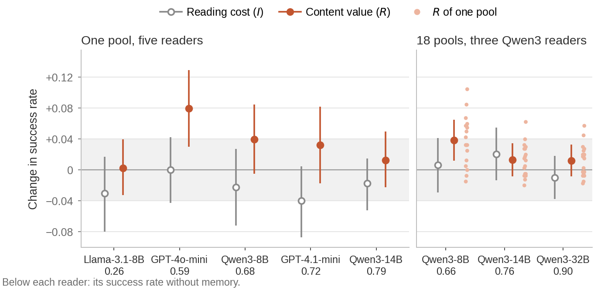

# SkillRC: Is It the Skill or the Stack?

**Auditing experience memory in agent harnesses**

Yiwen Lu, University of Notre Dame. Manuscript, 2026.

Contact: ylu37@nd.edu

[Paper (PDF)](paper/manuscript.pdf) · [Project page](https://eveneureka.github.io/SkillRC/)

## The question

A common way to let an LLM agent learn from experience is to distill its past runs into a short list
of rules and put the list in its prompt. The same list can help one model and do nothing for another,
or harm it. Is that because of what the rules say (the skill) or because of how each model reads added
text (the stack)?

**Answer.** The differences we could attribute are in the skill: no model pays a measurable cost for
reading the memory, while what the rules say is worth +0.08 to GPT-4o-mini, about +0.04 to Qwen3-8B, nothing
measurable to four other models, and a loss on WebShop.

SkillRC (a reality check for agent skills) separates the two parts. A control keeps everything about
the memory except its content: the same items, tags, word counts and order, and the same token count
under every reader's tokenizer. Each rule is replaced by a sentence about gardening, with a few words
replaced by a placeholder where needed to match token counts. The net effect of the memory then splits
into a **reading cost** (control minus no memory) and a **content value** (memory minus control).



*Reading cost and content value on 134 unseen ALFWorld games, with 95% intervals. Left: one pool read
by five models. Right: the mean over 18 pools for three Qwen3 models; dots are single pools.*

## Findings

1. **No reader pays a measurable reading cost.** Matched unrelated text changes ALFWorld success by at
   most 0.04 for each of six models, and no reader's reading cost is distinguishable from zero. Where a
   memory does nothing for a model, its content value is near zero too, so no reading cost is masking a
   gain.
2. **Content is worth something to two readers and lowers the score on WebShop.** For Qwen3-8B,
   averaged over 18 pools, the content value is +0.039 [0.012, 0.065]. GPT-4o-mini also gains reliably from a pool built
   from its own runs, while Qwen3-14B, Qwen3-32B, Llama-3.1-8B and GPT-4.1-mini gain nothing
   measurable. On WebShop the distilled rules lower the score of both readers that can do the task.
3. **For Qwen3 readers, distilled rules beat generic advice and the source agent made no difference.**
   For Qwen3-8B and Qwen3-14B, rules distilled from trajectories beat equally long rules written from the
   task description alone by +0.035 [0.014, 0.057] (the two lists were written by different models; see
   the paper). Qwen3-32B did not read the generic rules. For all three Qwen3 readers, with the same number
   of trajectories per task type from each source, it made no difference which agent supplied them. Pools built by the same pipeline differ
   from one another about as much as the effects, so a memory is best judged over several pools.

**Scope.** The one planned test of a difference between readers (Qwen3-8B against Qwen3-32B) was not
significant. The intervals of the differences between readers' reading costs reach 0.10, and changing
the control's topic from gardening to astronomy shifts the reading cost by 0.025. The readers are open
models of 8B to 32B parameters and two small hosted models. The predictions and analysis of each of the
five studies were written down before its runs, and the paper's Appendix A lists every prediction with
its outcome and marks the exploratory analyses.

## Reproduce

All commands run from the repository root.

### Setup

```bash
conda create -n skillrc python=3.10 -y && conda activate skillrc
pip install -r requirements.txt
bash scripts/setup_alfworld.sh          # ALFWorld data, pinned base config and ReAct demonstrations
export ALFWORLD_DATA=$PWD/data/alfworld
python tests/test_smoke_mock.py         # end-to-end check on a mock environment, no model needed
```

`data/alfworld_tasks/valid_unseen_gamefiles.json` lists the game behind each of the 134 test task ids,
so you can check that your ALFWorld download maps ids to the same games.

### Re-run the analyses without any model

`data/outcomes/` holds the per-episode outcome of every reported run (seed, task, success or score,
steps, memory tokens, and the actions the analyses need). Expand it into the layout the analysis scripts
read, then run them:

```bash
python scripts/outcomes.py unpack                        # writes results/*.episodes.jsonl and results/placebo/
python scripts/analysis/analyze_rerun_2026-10-10.py      # five-reader study, first 60-game batch
python scripts/analysis/analyze_phase2_2026-10-10.py     # five-reader study
python scripts/analysis/exploratory_phase2_2026-10-10.py # its two exploratory intervals
python scripts/analysis/analyze_webshop_2026-10-10.py    # WebShop study
python scripts/analysis/compliance_2026-10-11.py         # WebShop action counts (exploratory)
python scripts/analysis/w1a_2026-10-13.py                # crossover study
python scripts/analysis/w1b_2026-10-13.py                # generic-rule study
python scripts/analysis/poolrep_2026-10-12.py            # pool-replication study
```

Each script writes its JSON to `results/placebo/`. From the released outcomes, every one of them
reproduces the corresponding file in `data/summaries/` exactly. Numbers in the paper are rounded from
unrounded estimates; the JSON files round to four decimals. The figures are drawn from
`data/summaries/` with `python paper/figures/make_figures.py`, and `bash paper/build.sh` builds the PDF.

### Re-run the experiments with local readers

Serve a reader with vLLM (we used vLLM 0.24, bf16) under the name the configs expect:

```bash
vllm serve Qwen/Qwen3-8B --revision b968826d9c46dd6066d109eabc6255188de91218 \
  --served-model-name qwen3-8b --port 8000 --dtype bfloat16 --max-model-len 16384 --enforce-eager
#   Qwen3-14B:    --revision 40c069824f4251a91eefaf281ebe4c544efd3e18 --served-model-name qwen3-14b
#   Qwen3-32B:    --revision 9216db5781bf21249d130ec9da846c4624c16137 --served-model-name qwen3-32b --tensor-parallel-size 2
#   Llama-3.1-8B: unsloth/Llama-3.1-8B-Instruct --revision 4699cc75b550f9c6f3173fb80f4703b62d946aa5 --served-model-name llama-3.1-8b
```

The Qwen3 configs turn thinking off through `chat_template_kwargs`. Run all arms of one reader together,
so they share one time window and one server:

```bash
bash scripts/run_configs.sh http://127.0.0.1:8000/v1 configs/w1_2026_10_13/eval/*_Q8.yaml        # crossover and generic rules, Qwen3-8B
bash scripts/run_configs.sh http://127.0.0.1:8000/v1 configs/poolrep_2026_10_12/*.yaml           # pool replication, Qwen3-8B
bash scripts/run_configs.sh http://127.0.0.1:8000/v1 configs/phase2_2026_10_10/P2C_*_QWEN14B.yaml # five-reader study, Qwen3-14B
```

Outputs go to `results/<run_id>.episodes.jsonl` and `.summary.json`, and existing outputs are never
overwritten. `configs/w1_2026_10_13/eval/jobs_<reader>_S<k>.txt` list how the arms were split over two
servers in our runs.

### Hosted readers

GPT-4o-mini and GPT-4.1-mini configs call the OpenAI API. Set `OPENAI_API_KEY` in your environment and
run a config directly, for example
`python -m skillrc.runner --config configs/phase2_2026_10_10/P2B_true_GPT.yaml`.

### WebShop

WebShop runs need the official WebShop code (commit `64fa2a5c15c7`) in `third_party/WebShop`, in its
own Python 3.8 environment with JDK 11 for pyserini, as described in the WebShop repository. The
original data links no longer resolve; we used the 1,000-product files from the Hugging Face dataset
`YWZBrandon/webshop-data` (revision `ce990fff5aee388db2706f07820c578ab68e0453`:
`items_shuffle_1000.json`, `items_ins_v2_1000.json`, `items_human_ins.json`) and built the Lucene
indexes with WebShop's `search_engine/run_indexing.sh`. Then:

```bash
WEBSHOP_ENV=/path/to/webshop-env bash scripts/webshop/start_server.sh 3000 1000   # seeded server, waits for /health
bash scripts/run_configs.sh http://127.0.0.1:8000/v1 configs/webshop_2026_10_10/WS1010_*_QWEN.yaml
```

`scripts/webshop_server.py` seeds WebShop's random price generation (`--seed 0`, with
`PYTHONHASHSEED=0`), so every session gets the same instruction across restarts.
`data/summaries/webshop_2026-10-10/instructions_seed0_1k.json` holds the resulting instructions.

## Repository map

| Path | Contents |
|---|---|
| `skillrc/` | The harness: ReAct loop, memory insertion with BM25 ordering and token budget, ALFWorld and WebShop adapters, OpenAI-compatible client |
| `configs/` | One YAML per run: `phase2_2026_10_10` (five-reader study), `rerun_2026_10_10` (its first 60-game batch), `webshop_2026_10_10` (WebShop), `w1_2026_10_13` (crossover W1-A and generic-rule W1-B), `poolrep_2026_10_12` (pool replication), `source_2026_10_11` (the source collections and base configs the generators copy) |
| `data/pools/` | Memories and controls: the focal pool `expel_insights*`, the Qwen-sourced pool `src1011_qwen_insights`, the crossover pools `w1a_*`, the pool-replication pools `poolrep_*`, generic rules and astronomy controls `w1b_*`, the WebShop pool `webshop1010_*`, and the sentence banks |
| `data/outcomes/` | Per-episode outcomes of every reported run |
| `data/summaries/` | Result JSON of every study, control and injection audits, raw outputs of the generic-rule writer, WebShop instructions |
| `data/alfworld_tasks/` | The 134 test games in task-id order |
| `scripts/analysis/` | Pool distillation, control builders, injection audits and the analysis of each study |
| `scripts/webshop/` | WebShop pool, controls, configs and server launcher |
| `scripts/` | Config generators, `outcomes.py`, `run_configs.sh`, `setup_alfworld.sh` |
| `paper/` | LaTeX source, figure script and the PDF |
| `docs/` | Project page |

## Citation

```bibtex
@misc{lu2026skillrc,
  title  = {{SkillRC}: Is It the Skill or the Stack? Auditing Experience Memory in Agent Harnesses},
  author = {Lu, Yiwen},
  year   = {2026},
  note   = {Manuscript},
  url    = {https://github.com/EvenEureka/SkillRC}
}
```

## License

Apache License 2.0 (see `LICENSE`). The ACL style files `paper/acl.sty` and `paper/acl_natbib.bst` keep
their own terms (the latter carries its LPPL notice). ALFWorld and WebShop are MIT-licensed; Qwen3 is
released under Apache 2.0 and Llama 3.1 under its community license.
